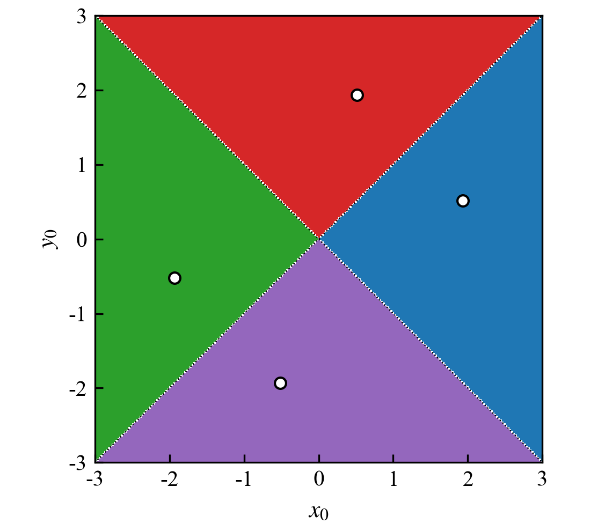

# newton-solve

二维非线性方程组的牛顿迭代求解器，带完整的失败诊断与恢复机制。

求解方程组

$$
\begin{cases}
x^2 + y^2 = 4,\\
xy = 1,
\end{cases}
$$

四个解析根为 $(\pm1.931852, \pm0.517638)$ 及其分量互换。程序在迭代过程中区分五种结局（收敛、奇异、发散、平台期、超迭代），对奇异点和平台期做随机扰动恢复，并把每次失败的原因和次数写进结果结构体。

## 特性

- 纯 C++17，无第三方依赖；2×2 线性系统按 Cramer 法则直接求解
- 五态状态机：`Converged` / `Singular` / `Diverged` / `Stagnated` / `MaxIter`
- 奇异点恢复：相对尺度的随机扰动，半径按 2 倍递增，最多 3 次
- 平台期检测：与历史最优残差比较，连续 15 步无刷新触发扰动
- 固定随机种子（`std::mt19937`，种子 12345），同初值多次运行结果一致
- CMake 构建，GitHub Actions 在 Linux / Windows 双平台编译并冒烟测试

## 快速开始

要求 CMake ≥ 3.15 与支持 C++17 的编译器。

Windows（MSVC）：

```powershell
cmake -S . -B build -G "Visual Studio 17 2022" -A x64
cmake --build build --config Release
.\build\main.exe
```

Linux / macOS：

```bash
cmake -S . -B build -DCMAKE_BUILD_TYPE=Release
cmake --build build -j
./build/main
```

程序启动后先对三个奇异初值跑一遍，再从标准输入读取初值：

```text
find results:1.93185,0.517638
find results:1.93185,0.517638
find results:-0.517638,-1.93185

input x0 y0: 2 1
find results:1.93185,0.517638
```

## 内置测试

启动时对三个奇异初值各跑一次迭代，验证扰动恢复：

| 初值 | 状态 | 迭代 | 奇异救援 | 终点 |
|---|---|---|---|---|
| (0, 0) | Converged | 13 | 1 | (1.93185, 0.517638) |
| (3, 3) | Converged | 6 | 1 | (1.93185, 0.517638) |
| (-1, -1) | Converged | 7 | 1 | (-0.517638, -1.93185) |

更完整的用例（平滑初值、发散、平台期）及数据见 [docs/report.md](docs/report.md)。

## 收敛域

在 $[-3,3]^2$ 上按 241×241 网格扫描，收敛成功率 99.17%，失败点全部落在雅可比矩阵的奇异线 $x=\pm y$ 上；四个扇区分别对应四个根。



## 目录结构

```text
.
├── CMakeLists.txt
├── README.md
├── LICENSE
├── src/
│   ├── function.cpp        求解器与状态机
│   └── main.cpp            测试入口与交互
├── scripts/
│   ├── plot_figures.py     报告配图生成
│   └── requirements.txt
├── docs/
│   ├── report.md           完整技术报告
│   └── fig/                配图
└── .github/workflows/build.yml
```

## 技术报告

收敛性分析、失败处理策略与完整测试数据见 [docs/report.md](docs/report.md)，排版后的版本在 [docs/report.pdf](docs/report.pdf)。

## 重新生成配图

```bash
pip install -r scripts/requirements.txt
python scripts/plot_figures.py
```

图片写到 `docs/fig/`，字体使用 Times New Roman，300 dpi。

## 许可

[MIT](LICENSE)
