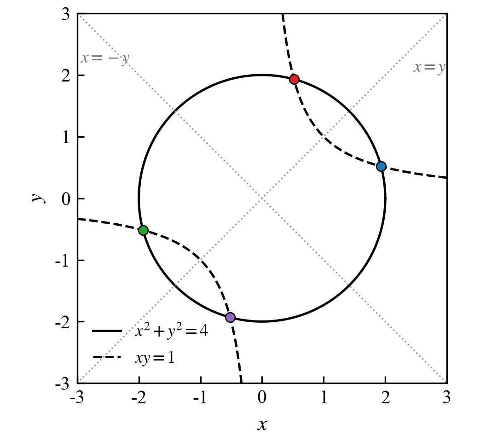
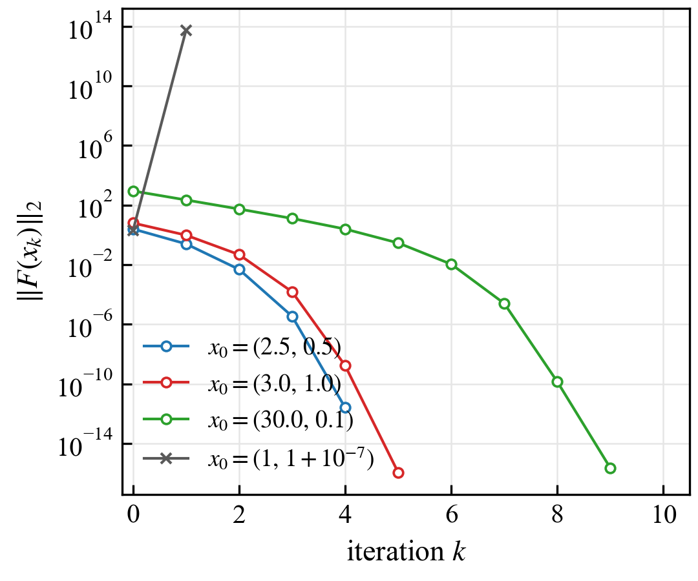
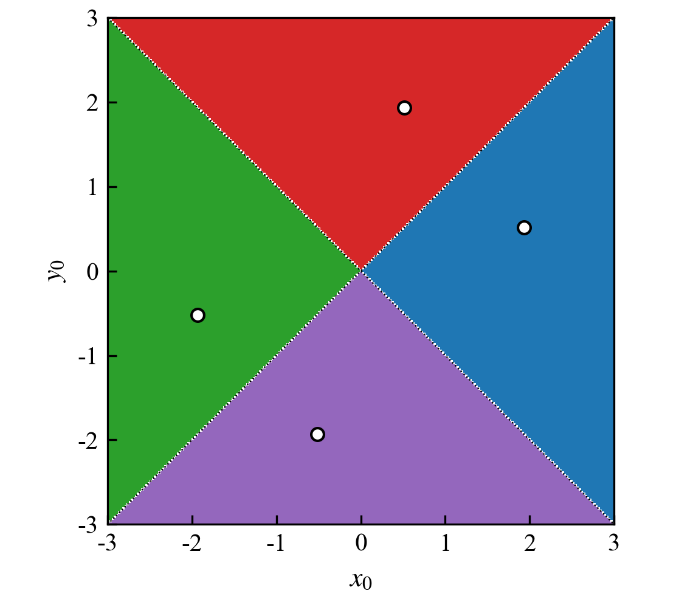
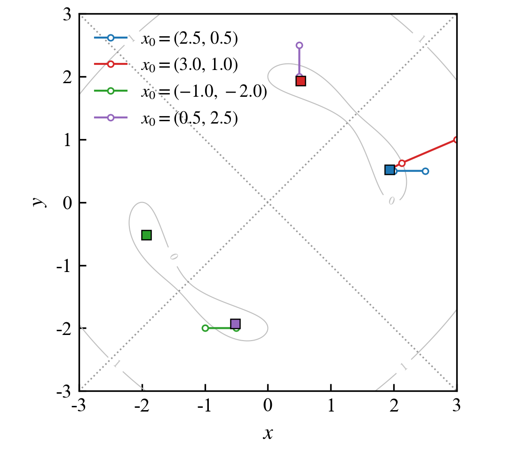

# 非线性方程组的牛顿迭代求解

## 1 问题

求解方程组

$$
\begin{cases}
x^2 + y^2 = 4,\\
xy = 1.
\end{cases}
$$

两式相加、相减分别得到 $(x+y)^2 = 6$、$(x-y)^2 = 2$，故解析解为

$$
x = \pm\frac{\sqrt{6}+\sqrt{2}}{2},\qquad y = \pm\frac{\sqrt{6}-\sqrt{2}}{2},
$$

或两个分量互换，共 4 组：

| 根 | $x$ | $y$ | 残差 $\|F\|_2$ |
|---|---|---|---|
| 1 | 1.931852 | 0.517638 | $9.9\times10^{-16}$ |
| 2 | 0.517638 | 1.931852 | $9.9\times10^{-16}$ |
| 3 | −1.931852 | −0.517638 | $9.9\times10^{-16}$ |
| 4 | −0.517638 | −1.931852 | $9.9\times10^{-16}$ |

几何上是一个半径 2 的圆与双曲线 $xy=1$ 的 4 个交点（图 1）。



**图 1** 两方程的零点集（实线圆、虚线双曲线）及其 4 个交点，点线为雅可比矩阵的奇异线 $x=\pm y$。

记 $F(x)=\bigl[x^2+y^2-4,\;xy-1\bigr]^{\mathsf T}$，雅可比矩阵及行列式为

$$
J(x)=\begin{bmatrix}2x & 2y\\ y & x\end{bmatrix},
\qquad
\det J = 2(x^2-y^2)=2(x-y)(x+y).
$$

$\det J$ 在 $x=y$ 与 $x=-y$ 两条直线上恒为零，这两条线是算法的天然障碍。

## 2 方法与实现

牛顿迭代

$$
x_{k+1} = x_k - J(x_k)^{-1}F(x_k),
$$

每步解一个 2×2 线性系统，用 Cramer 法则直接写出，不依赖线性代数库：

$$
\Delta x = \frac{f_1 J_{11} - J_{01} f_2}{\det J},\qquad
\Delta y = \frac{J_{00} f_2 - f_1 J_{10}}{\det J}.
$$

对应代码：`update()` 负责判奇异并执行一步更新，`iteration()` 负责外层循环与状态判定。终止条件为 $\|F(x_k)\|_2 < \text{tol}$，默认 $\text{tol}=10^{-10}$，迭代上限 100 步。

## 3 收敛性质

### 3.1 二次收敛

以 $x_0=(2.5,\,0.5)$ 为例，残差序列为

| $k$ | 0 | 1 | 2 | 3 | 4 |
|---|---|---|---|---|---|
| $\|F\|$ | 2.512 | $2.500\times10^{-1}$ | $4.851\times10^{-3}$ | $3.447\times10^{-6}$ | $2.523\times10^{-12}$ |
| 比值 | — | $9.95\times10^{-2}$ | $1.94\times10^{-2}$ | $7.11\times10^{-4}$ | $7.32\times10^{-7}$ |

相邻残差的比值逐级变小，残差量级每步约翻倍下降，符合牛顿法在单根附近的二阶收敛（图 3）。从远处的初值（如 $(30,\,0.05)$）出发，前几步先以线性速度把量级拉回，进入根的邻域后才转为平方下降，这也说明收敛是局部的。



**图 3** 不同初值的残差历史。实心点连线为正常收敛；灰色叉号为 $x_0=(1,\,1+10^{-7})$ 的第一步，残差从 2.0 跃升到 $5.6\times10^{13}$，被发散判据拦下。

### 3.2 收敛域

在 $[-3,3]^2$ 上做 241×241 网格扫描，每个格点独立迭代，按收敛到的根着色（图 4）。收敛成功率为 **99.17%**，失败点全部落在两条奇异线 $x=\pm y$ 上（零测集）。四个扇区分别对应 4 个根，分界面正是两条奇异线。



**图 4** 收敛域：颜色表示初值最终收敛到的根，白色细线为奇异线。除 $x=\pm y$ 外全域收敛。

图 2 给出 4 条典型轨迹。轨迹在根的邻域内几乎垂直地落向根，说明一次线性化模型在该处已足够准确。



**图 2** 牛顿迭代轨迹叠加在 $\log_{10}\|F\|$ 的等值线上，方块为根的位置。

### 3.3 初值的取法

牛顿法只在根的邻域内保证收敛，初值决定了迭代能不能起步。常用的取法有下面几类，代价从低到高。

**解析近似。** 方程有可解结构时先解简化模型。本题两式相加、相减得到 $(x+y)^2=6$、$(x-y)^2=2$，初值直接取

$$
x_0=\Bigl(\frac{\sqrt6+\sqrt2}{2},\ \frac{\sqrt6-\sqrt2}{2}\Bigr),
$$

或其对称点即可。一般情况下把高阶项丢掉、固定部分耦合项做线性化，得到的近似解只要落在根的邻域内就够用——牛顿法要的是"近"，不是"准"。

**几何或物理直觉。** 本题是半径 2 的圆与双曲线 $xy=1$ 的交点，图上可以看出交点在第一、三象限且 $|x|>|y|$，取 $(1.5,\,0.5)$ 这类落在扇形内部的点就行。第 3.2 节的扫描结果也说明，只要不落在 $x=\pm y$ 附近，初值在扇区内的具体位置对是否收敛影响不大。

**延拓法。** 初值离根很远时，构造

$$
H(x,t)=F(x)-(1-t)F(x_0),\qquad t:0\to1,
$$

$t=0$ 时 $x_0$ 是 $H(x,0)=0$ 的精确根，$t$ 每走一步都拿上一步的解当初值，方程逐步从"容易解的那个"过渡到原方程。以 $(1,\,1+10^{-7})$ 为例，裸牛顿第一步残差就从 2.0 跳到 $5.6\times10^{13}$，延拓用 66 步内层迭代收敛。代价是要多解几十次线性化系统。

**全局搜索。** 完全没有先验时，先用全局算法把点带进某个收敛域，再交给牛顿。粒子群是其中常用的一种：在搜索区域里撒 $N$ 个粒子，每个粒子按自身历史最优位置和群体最优位置更新速度，

$$
v_i \leftarrow \omega v_i + c_1 r_1 (p_i - x_i) + c_2 r_2 (g - x_i),\qquad x_i \leftarrow x_i + v_i,
$$

适应度取 $\tfrac12\|F(x_i)\|^2$，迭代若干代后把最优粒子的位置作为牛顿初值；差分进化、遗传算法同理。这类方法的开销是 $O(N\times\text{代数})$ 次残差计算，不保证找到全部根，但足以避免随手给个初值就发散。

**初值的检验。** 拿到初值可以先用两个便宜指标筛一下：一是 $\det J$ 不接近零，本题 $\det J=2(x^2-y^2)$，初值不应落在 $x=\pm y$ 附近；二是看前两三步残差是否单调下降，第一步反而变大说明初值在收敛域边缘，换点或改用延拓更稳妥。

## 4 失败情形的识别与处理

牛顿法只在根的邻域内可靠，实现中把"失败"分成四类并分别处理，`Status` 的五个取值与判定条件如下：

| 状态 | 判定条件 | 处理 |
|---|---|---|
| `Converged` | $\|F\|<\text{tol}$ | 返回解 |
| `Singular` | $\|\det J\|<10^{-10}$ | 随机扰动后继续，最多 3 次 |
| `Diverged` | $\|F\|>10^{9}$ | 返回，提示更换初值 |
| `Stagnated` | 连续 15 步残差无下降 | 扰动后重新观察，剩余迭代不足以再观察一轮时返回 |
| `MaxIter` | 迭代次数用尽 | 返回当前点 |

### 4.1 奇异：扰动逃逸

$\det J$ 在 $x=\pm y$ 上为零，牛顿步无定义。此时给当前点叠加一个各分量独立的均匀随机扰动：

$$
x \leftarrow x + \xi,\qquad
\xi_i \sim U(-\rho,\ \rho),\quad
\rho = 0.1\cdot 2^{\,n}\cdot \max(1, |x_1|, |x_2|),
$$

其中 $n$ 是该类救援已用的次数，半径按 2 倍递增，使一次逃逸失败后下一次的步子更大。缩放到 $\max(1,|x|)$ 让扰动幅度与变量量级匹配。两条奇异线上任取一点，扰动后 $\det J \approx 4t\delta$（$t$ 为到原点距离），当 $\delta\sim0.1t$ 时行列式远离零，迭代即可恢复正常。

### 4.2 发散：阈值拦截

一旦 $\|F\|>10^{9}$，继续迭代只会放大数值误差，直接返回 `Diverged`。例如 $x_0=(1,\,1+10^{-7})$ 距奇异线仅 $10^{-7}$，第一步的步长被病态雅可比放大约 $5\times10^{6}$ 倍，残差从 2.0 升到 $5.6\times10^{13}$。

### 4.3 平台期：历史最优判据

精度地板附近残差会在 $10^{-16}$ 量级抖动，"和上一步比"会把噪声当进展、停机计数永远清零。实现改为与历史最优残差比较：只有刷新纪录才算进展，连续 15 步没有刷新即判为平台期，扰动后重新观察。

放弃条件与迭代预算挂钩：若剩余迭代不足以完整观察一个 15 步窗口（`i + 15 >= iter`），就不再扰动，直接返回 `Stagnated`。这样停机次数不需要额外计数器，也不受"救几次"的硬编码限制。

### 4.4 扰动后的状态复位

扰动是一次残差跳变，旧的历史不能沿用。两处救援之后都把历史最优重置为哨兵值 `kUnset = 1e30`，停机计数清零；奇异救援还会把 `singular_tries` 加一并清空停滞计数，否则救援路径会被误判为停滞或发散。

## 5 测试结果

`test()` 在启动时对三个奇异初值各跑一次迭代，验证扰动恢复；下表是同一接口下更完整的用例集合：

| 用例 | 初值 | tol | 状态 | 迭代 | 奇异救援 | 终点 |
|---|---|---|---|---|---|---|
| smooth | (2.5, 0.5) | $10^{-10}$ | Converged | 4 | 0 | (1.93185, 0.517638) |
| smooth | (3.0, 1.0) | $10^{-10}$ | Converged | 5 | 0 | (1.93185, 0.517638) |
| singular | (0, 0) | $10^{-10}$ | Converged | 13 | 1 | (1.93185, 0.517638) |
| singular | (3, 3) | $10^{-10}$ | Converged | 6 | 1 | (1.93185, 0.517638) |
| singular | (-1, -1) | $10^{-10}$ | Converged | 7 | 1 | (-0.517638, -1.93185) |
| diverged | (1, 1+$10^{-7}$) | $10^{-10}$ | Diverged | 1 | 0 | (−5e6, 5e6) |
| stagnated | (2.5, 0.5) | $10^{-20}$ | Stagnated | 83 | 0 | (1.93185, 0.517638) |

几点说明：

- 三个奇异初值本来一步都走不动，扰动一次即离开对角线上，随后纯牛顿在 6~13 步内收敛；
- 不可达精度用例在 $10^{-16}$ 附近抖动，判为平台期后多次扰动仍无法达到 $10^{-20}$，在剩余预算不足一个观察窗口时返回 `Stagnated`，此时返回的仍是找到的最优解；
- 随机数用 `std::mt19937` 固定种子 12345，同一初值多次运行结果完全一致，便于回归测试。

`test()` 的输出（三行）：

```
find results:1.93185,0.517638
find results:1.93185,0.517638
find results:-0.517638,-1.93185
```

## 6 代码组织与使用

| 文件 | 内容 |
|---|---|
| `src/function.cpp` | 类型定义、$F$、$J$、单步更新 `update()`、扰动 `update_init_result()`、主循环 `iteration()` |
| `src/main.cpp` | 测试用例 `test()`、交互入口 `main()` |
| `scripts/plot_figures.py` | 报告配图的生成脚本（matplotlib，Times New Roman） |
| `docs/fig/*.png` | 图 1~4 |

编译（Windows + MSVC）：

```powershell
cmake -S . -B build -G "Visual Studio 17 2022" -A x64
cmake --build build --config Release
.\build\main.exe
```

程序先对三个奇异初值各跑一次，随后从标准输入读取初值：

```text
find results:1.93185,0.517638
find results:1.93185,0.517638
find results:-0.517638,-1.93185

input x0 y0: 2 1
find results:1.93185,0.517638
```
